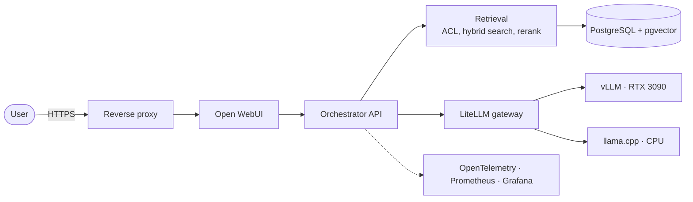

# SummerAI

A self-hosted AI platform that answers questions over private documents, with
cited sources and per-user access control. It is built and operated like
production infrastructure: segmented network, infrastructure as code,
observability, and measured quality and performance.

> **Status: early development.** The design and the v1 roadmap are done; model
> serving (milestone M1) is next. This README only reports what exists and
> what has been measured. See the [roadmap](docs/roadmap.md).

## Why

Many organisations cannot send internal documents to a public LLM API.
SummerAI covers the self-hosted alternative end to end:

- local models behind one authenticated, OpenAI-compatible gateway;
- retrieval that enforces who can read what, and cites its sources;
- an agent layer whose tools are explicitly allow-listed;
- the security, infrastructure and measurement work needed to run it
  reliably.

The reference use case is a private assistant for **Essential Eight
compliance and IT operations**: it answers over public ASD guidance and a
fictional company's confidential runbooks, and each role only sees what it is
allowed to read. See the [use case](docs/use-case.md).

## What v1 delivers

| Capability | Milestone | Status |
|---|---|---|
| vLLM (GPU) and llama.cpp (CPU) behind a LiteLLM gateway with API keys | M1 | Planned |
| Hybrid retrieval (vector and full-text) with reranking and cited answers | M2 | Planned |
| Per-user access control enforced inside the retrieval query | M2 | Planned |
| Evaluation on a golden dataset, run in CI | M3 | Planned |
| Per-request traces, metrics and Grafana dashboards | M3 | Planned |
| Hardware benchmarks and cost per million tokens, local versus cloud | M3 | Planned |
| Planner, executor and reviewer agents with JSON contracts | M4 | Planned |
| Prompt-injection and cross-user leakage test suites | M5 | Planned |
| Terraform and Ansible deployment on Proxmox, tested backup and restore | M5 | Planned |

## Architecture

Details, data flows and design choices: [architecture](docs/architecture.md)
and [decision records](docs/adr/).

## Homelab

| Role | Hardware |
|---|---|
| GPU hypervisor | AMD Ryzen 7 (8 cores), 32 GB RAM, NVIDIA RTX 3090 (24 GB), Proxmox VE |
| Main hypervisor | Dell PowerEdge R730, Intel Xeon E5-2680 v4, 96 GB RAM, Proxmox VE |
| Firewall and inter-VLAN routing | Fortinet FortiGate 40F |
| Switch | Cisco CBS250 |

Management, servers and IoT are separate VLANs with default-deny routing
between them. Nothing is exposed to the internet.

## Results

None yet. Evaluation scores and benchmarks will be published here once they
are produced by the scripts in this repository, together with the hardware,
model, settings and commit used.

## Getting started

Not available yet. The quickstart arrives with milestone M1 and will run on a
machine without a GPU.

## Documentation

- [Use case](docs/use-case.md)
- [Roadmap to v1](docs/roadmap.md) and [long-term roadmap](docs/roadmap-long-term.md)
- [Architecture](docs/architecture.md)
- [Architecture decision records](docs/adr/)
- [Idea backlog](docs/ideas.md)
- [Changelog](CHANGELOG.md)

## Contributing and security

See [CONTRIBUTING.md](CONTRIBUTING.md). Please report vulnerabilities
privately, as described in [SECURITY.md](SECURITY.md).

## License

[Apache License 2.0](LICENSE).
