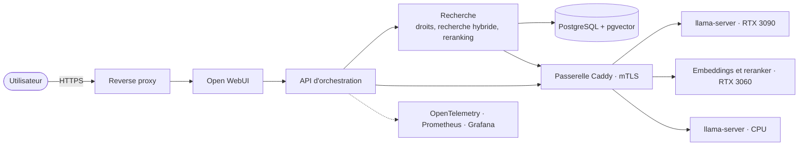

# SummerAI

Une plateforme d'IA auto-hébergée qui répond à des questions sur des documents
privés, en citant ses sources et en respectant les droits d'accès de chaque
utilisateur. Elle est construite et exploitée comme une infrastructure de
production : réseau segmenté, infrastructure as code, observabilité, qualité
et performances mesurées.

SummerAI est aussi la vitrine et la base technique d'une activité
d'installation d'infrastructures IA et RAG en entreprise.

> **État : développement en cours.** La conception et la feuille de route de
> la v1 sont faites ; le service des modèles (jalon M1) est en cours. Ce README
> ne présente que ce qui existe et ce qui a été mesuré. Voir la
> [feuille de route](docs/roadmap.md).

## Pourquoi

Beaucoup d'organisations ne peuvent pas envoyer leurs documents internes à une
API de modèle de langage publique. SummerAI couvre l'alternative auto-hébergée
de bout en bout :

- des modèles locaux derrière une seule passerelle authentifiée, compatible
  OpenAI ;
- une recherche documentaire qui applique les droits de lecture et cite ses
  sources ;
- une couche d'agents dont les outils sont explicitement autorisés ;
- le travail de sécurité, d'infrastructure et de mesure nécessaire pour la
  faire tourner de façon fiable.

Le cas d'usage de référence est un **assistant de conformité cyber** : il
répond en s'appuyant sur les publications de l'ANSSI (guide d'hygiène
informatique, référentiel ReCyF pour la directive NIS 2) et sur les
procédures confidentielles d'une entreprise fictive, et chaque rôle ne voit que
ce qu'il a le droit de lire. Voir le [cas d'usage](docs/use-case.md).

## Ce que livre la v1

| Fonction | Jalon | État |
|---|---|---|
| Serveurs de modèles llama.cpp sur deux GPU et sur CPU, derrière une passerelle Caddy avec TLS mutuel | M1 | En cours |
| Recherche hybride (vectorielle et plein texte) avec reranking et réponses citées | M2 | Prévu |
| Contrôle d'accès par utilisateur appliqué dans la requête de recherche | M2 | Prévu |
| Évaluation sur un jeu de référence, lancée en CI | M3 | Prévu |
| Traces par requête, métriques et tableaux de bord Grafana | M3 | Prévu |
| Mesures matérielles et coût par million de jetons, local contre cloud | M3 | Prévu |
| Agents planificateur, exécutant et relecteur avec contrats JSON | M4 | Prévu |
| Suites de tests d'injection de prompt et de fuite entre utilisateurs | M5 | Prévu |
| Déploiement Terraform et Ansible sur Proxmox, sauvegarde et restauration testées | M5 | Prévu |

## Architecture

Détails, flux de données et choix de conception :
[architecture](docs/architecture.md) et
[décisions d'architecture](docs/adr/).

## Homelab

| Rôle | Matériel |
|---|---|
| Hyperviseur GPU | Intel Core i5-14400F, 32 Go de DDR5, NVIDIA RTX 3090 (24 Go) et RTX 3060 (8 Go), Proxmox VE |
| Hyperviseur principal | Dell PowerEdge R730, 2 × Intel Xeon E5-2680 v4, 96 Go de mémoire, Proxmox VE |
| Pare-feu et routage entre VLAN | Fortinet FortiGate 40F |
| Switch | Cisco CBS250 |

Administration, serveurs et objets connectés sont dans des VLAN séparés, et
tout flux entre eux est refusé par défaut. Rien n'est exposé sur internet.

## Résultats

Chaque résultat est produit par un script de ce dépôt et publié avec le
matériel, le modèle, les réglages et le commit utilisés.

- [Limite de puissance, RTX 3090](benchmarks/power-limit/) : à 300 W au lieu
  de 350 W, la génération est 2,9 % plus lente pour 8,8 % de puissance en
  moins.

Les scores d'évaluation suivront au jalon M3.

## Démarrage

Pas encore disponible. Le démarrage rapide arrive avec le jalon M1 et
tournera sur une machine sans GPU.

## Documentation

- [Cas d'usage](docs/use-case.md)
- [Feuille de route vers la v1](docs/roadmap.md) et [feuille de route à long terme](docs/roadmap-long-term.md)
- [Architecture](docs/architecture.md)
- [Runbook de l'hôte GPU](docs/runbooks/gpu-host.md)
- [Boucle de travail déléguée](docs/delegated-loop.md) : comment le projet est construit avec des modèles locaux et distants
- [Décisions d'architecture](docs/adr/)
- [Réserve d'idées](docs/ideas.md)
- [Journal des modifications](CHANGELOG.md)

## Contribution et sécurité

Voir [CONTRIBUTING.md](CONTRIBUTING.md). Merci de signaler les vulnérabilités
en privé, comme indiqué dans [SECURITY.md](SECURITY.md).

## Licence

[Licence Apache 2.0](LICENSE).
