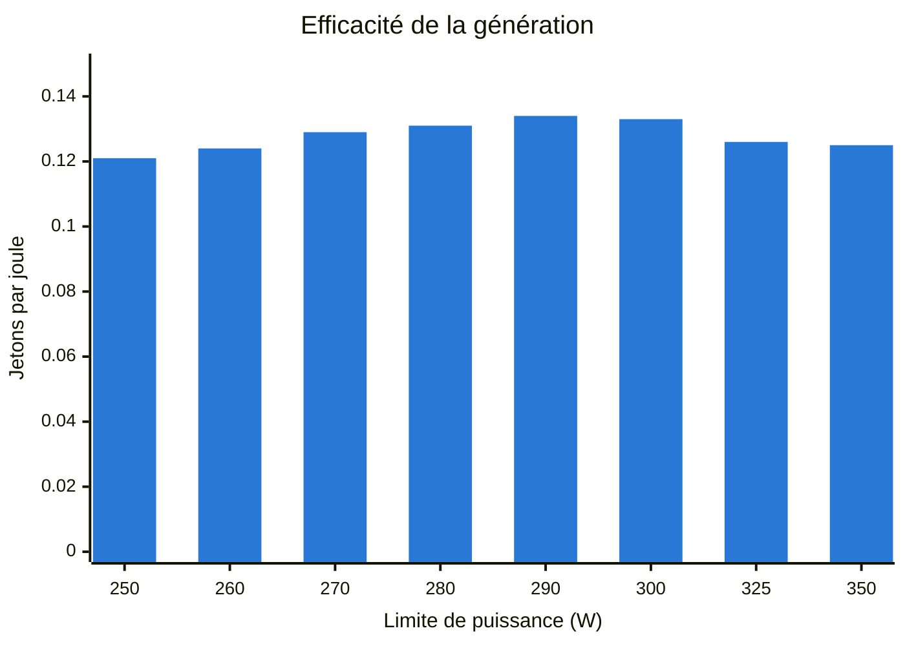
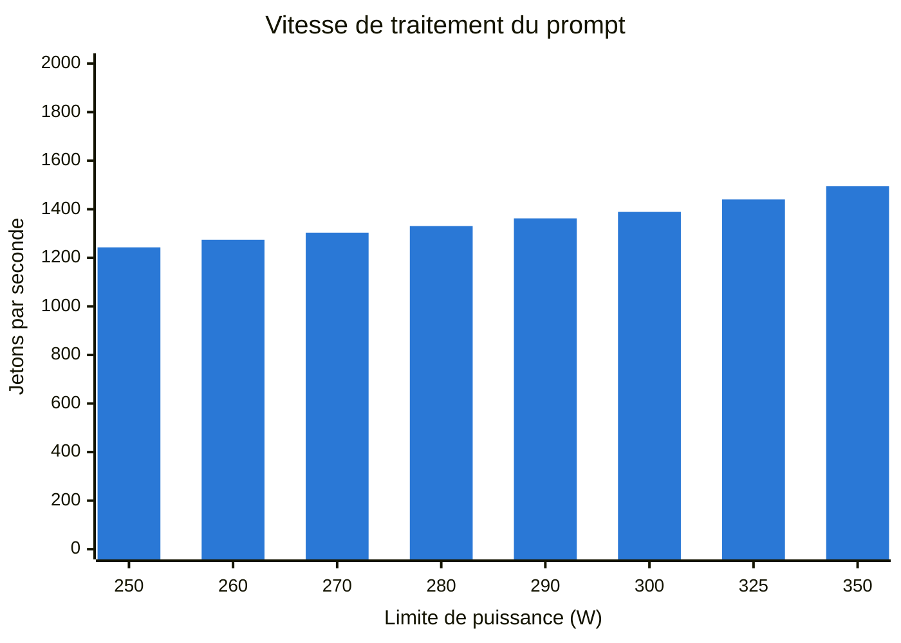
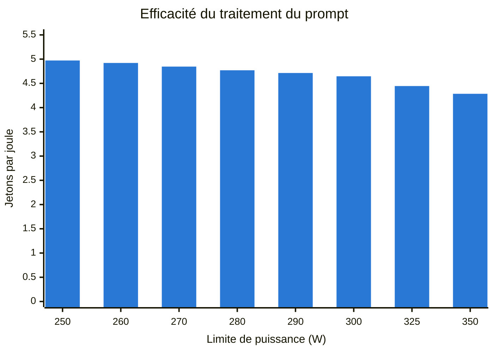

# Limite de puissance : RTX 3090

Quelle vitesse la RTX 3090 perd-elle quand sa limite de puissance est
abaissée, avec le modèle qu'elle sert ? Mesuré le 2026-10-19 avec
[`power-limit.sh`](../../scripts/bench/power-limit.sh).

**Résultat :** à 300 W au lieu de 350 W, la génération est 2,9 % plus lente et
le traitement du prompt 7,1 % plus lent, tandis que la carte consomme 8,8 % de
puissance en moins pendant la génération et 14,3 % en moins pendant le
traitement du prompt. La carte tourne désormais à 300 W.

## Configuration

| | |
|---|---|
| GPU | NVIDIA GeForce RTX 3090 (MSI Ventus 3X OC), plage de limite 100-350 W, 350 W par défaut |
| Pilote | 595.104.02 |
| llama.cpp | v0.7.0 (`620d222`), CUDA 13.1, `llama-bench` |
| Modèle | `Qwen3.8-27B-UD-Q4_K_XL.gguf` ([révision](../../docs/runbooks/gpu-host.md#versions-épinglées)) |
| Réglages | Les mêmes que le service : toutes les couches sur le GPU, flash attention, cache clé-valeur `q8_0`, E/S directes |
| Tests | Traitement d'un prompt de 4096 jetons, génération de 128 jetons, contexte vide, 5 répétitions chacun |
| Puissance | Puissance de la carte rapportée par `nvidia-smi` toutes les 0,5 s ; médiane des échantillons pris pendant que l'utilisation du GPU était d'au moins 80 % |

## Résultats

La génération est la vitesse que l'utilisateur ressent pendant que la réponse
s'écrit. Le traitement du prompt est l'attente avant le premier mot, et
augmente avec la taille du contexte récupéré.








Les barres sont espacées de façon régulière, alors que les limites ne le sont
pas : le pas est de 25 W au-dessus de 300 W et de 10 W en dessous.

| Limite (W) | Prompt 4096 (tok/s) | Puissance (W) | Prompt (tok/J) | Génération 128 (tok/s) | Puissance (W) | Génération (tok/J) |
|---:|---:|---:|---:|---:|---:|---:|
| 350 | 1495.5 ± 4.1 | 349 | 4.285 | 40.9 ± 0.0 | 328 | 0.125 |
| 325 | 1440.3 ± 2.3 | 324 | 4.445 | 40.7 ± 0.0 | 324 | 0.126 |
| 300 | 1389.1 ± 1.9 | 299 | 4.646 | 39.7 ± 0.1 | 299 | 0.133 |
| 290 | 1362.5 ± 1.7 | 289 | 4.714 | 38.7 ± 0.1 | 290 | 0.134 |
| 280 | 1330.8 ± 1.9 | 279 | 4.770 | 36.7 ± 0.2 | 280 | 0.131 |
| 270 | 1303.6 ± 1.7 | 269 | 4.846 | 34.7 ± 0.2 | 270 | 0.129 |
| 260 | 1274.5 ± 1.5 | 259 | 4.921 | 32.4 ± 0.1 | 260 | 0.124 |
| 250 | 1243.1 ± 1.5 | 250 | 4.972 | 30.2 ± 0.1 | 250 | 0.121 |

Le débit est la moyenne des 5 répétitions ± leur écart type. Le tableau reprend le
[`summary.md`](rtx3090-20261019T203445Z/summary.md) écrit par le script, avec
des en-têtes traduits.

## Lecture

- **La génération utilise à peine la marge au-dessus de 300 W.** À la limite
  de 350 W, elle consomme 328 W, sous la limite. Jusqu'à 300 W, elle perd
  2,9 % ; sous 290 W, la perte augmente vite, jusqu'à 26,2 % à 250 W.
- **L'efficacité de la génération culmine à 290-300 W**, avec environ 6-7 % de
  jetons par joule de plus qu'à 350 W. Sous 280 W, la carte est plus lente
  sans économiser d'énergie par jeton.
- **Le traitement du prompt est limité par le calcul :** il consomme toute la
  limite à chaque palier, et son efficacité continue de s'améliorer jusqu'à
  250 W.

## Décision

La limite est fixée à **300 W** au démarrage par
[`nvidia-power-limits.service`](../../deploy/merlin/host/nvidia-power-limits.service).
290 W est un peu plus efficace, mais coûte 5,4 % de vitesse de génération au
lieu de 2,9 %. La limite plus basse réduit aussi la charge de pointe sur
l'alimentation, que la RTX 3060 partage.

## Limites

- Puissance de la carte telle que rapportée par le pilote, pas puissance à la
  prise.
- Une seule exécution, une seule carte. Le balayage est allé de la limite la
  plus haute à la plus basse : la température maximale de la carte est passée
  de 76 °C au premier test à 80 °C, donc les limites basses ont tourné sur une
  carte plus chaude.
- Contexte vide et une seule requête. La vitesse avec un long contexte et avec
  des requêtes simultanées est mesurée à part.

## Reproduire

Sur l'hôte Proxmox, en root, avec le conteneur LLM démarré :

```bash
scripts/bench/power-limit.sh <container id> <gpu PCI bus id> 350 325 300 290 280 270 260 250
scripts/bench/power-limit-charts.sh power-limit-<timestamp>/summary.md
```

Le script arrête `llama-server` pendant le balayage, puis rétablit la limite
précédente et le redémarre. Les [fichiers bruts](rtx3090-20261019T203445Z/)
contiennent, pour chaque limite et chaque test, la sortie JSON et le journal
de `llama-bench`, ainsi que les échantillons de puissance, d'utilisation, de
température et de fréquence.
