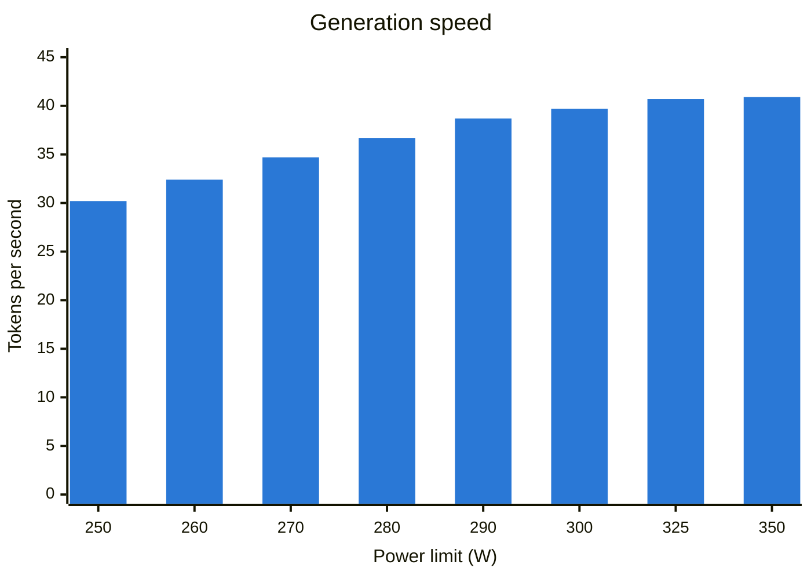
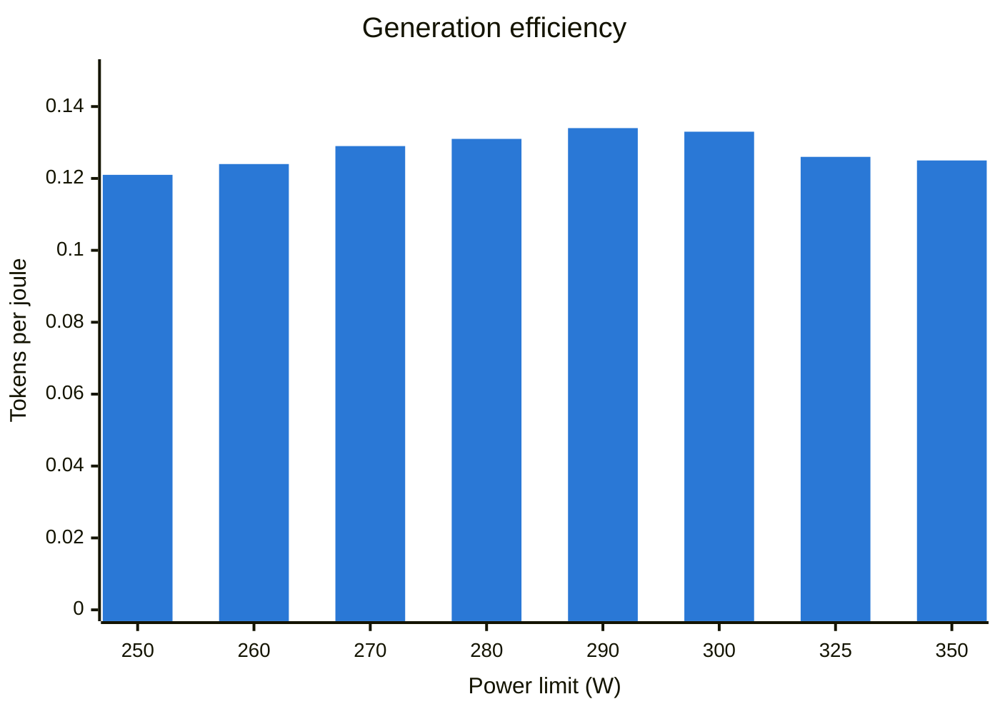
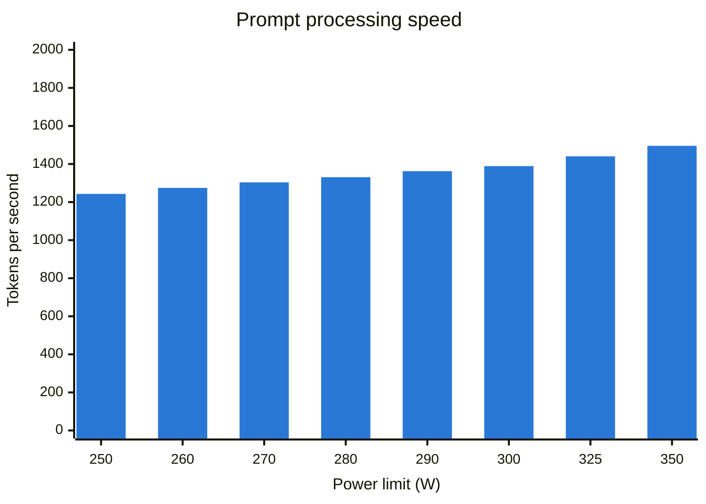
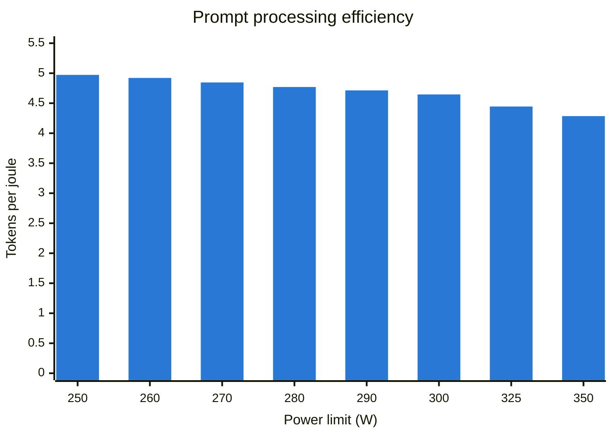

# Power limit: RTX 3090

How much speed does the RTX 3090 lose when its power limit is lowered, with
the model it serves? Measured on 2026-10-19 with
[`power-limit.sh`](../../scripts/bench/power-limit.sh).

**Result:** at 300 W instead of 350 W, generation is 2.9 % slower and prompt
processing 7.1 % slower, while the board draws 8.8 % less power during
generation and 14.3 % less during prompt processing. The card now runs at
300 W.

## Setup

| | |
|---|---|
| GPU | NVIDIA GeForce RTX 3090 (MSI Ventus 3X OC), limit range 100-350 W, default 350 W |
| Driver | 595.104.02 |
| llama.cpp | v0.7.0 (`620d222`), CUDA 13.1, `llama-bench` |
| Model | `Qwen3.8-27B-UD-Q4_K_XL.gguf` ([revision](../../docs/runbooks/gpu-host.md#pinned-versions)) |
| Settings | Same as the service: all layers on the GPU, flash attention, `q8_0` key-value cache, direct I/O |
| Tests | Prompt processing of 4096 tokens, generation of 128 tokens, empty context, 5 repetitions each |
| Power | Board power reported by `nvidia-smi` every 0.5 s; median of the samples taken while GPU utilisation was at least 80 % |

## Results

Generation is the speed a user feels while the answer is written. Prompt
processing is the wait before the first word, and grows with the size of the
retrieved context.









The bars are evenly spaced, although the limits are not: the step is 25 W
above 300 W and 10 W below.

| Limit (W) | Prompt 4096 (tok/s) | Power (W) | Prompt (tok/J) | Generation 128 (tok/s) | Power (W) | Generation (tok/J) |
|---:|---:|---:|---:|---:|---:|---:|
| 350 | 1495.5 ± 4.1 | 349 | 4.285 | 40.9 ± 0.0 | 328 | 0.125 |
| 325 | 1440.3 ± 2.3 | 324 | 4.445 | 40.7 ± 0.0 | 324 | 0.126 |
| 300 | 1389.1 ± 1.9 | 299 | 4.646 | 39.7 ± 0.1 | 299 | 0.133 |
| 290 | 1362.5 ± 1.7 | 289 | 4.714 | 38.7 ± 0.1 | 290 | 0.134 |
| 280 | 1330.8 ± 1.9 | 279 | 4.770 | 36.7 ± 0.2 | 280 | 0.131 |
| 270 | 1303.6 ± 1.7 | 269 | 4.846 | 34.7 ± 0.2 | 270 | 0.129 |
| 260 | 1274.5 ± 1.5 | 259 | 4.921 | 32.4 ± 0.1 | 260 | 0.124 |
| 250 | 1243.1 ± 1.5 | 250 | 4.972 | 30.2 ± 0.1 | 250 | 0.121 |

Throughput is the mean of 5 repetitions ± their standard deviation. The table
is the [`summary.md`](rtx3090-20261019T203445Z/summary.md) written by the
script.

## Reading

- **Generation barely uses the headroom above 300 W.** At the 350 W limit it
  draws 328 W, below the limit. Down to 300 W it loses 2.9 %; below 290 W the
  loss grows quickly, to 26.2 % at 250 W.
- **Generation efficiency peaks at 290-300 W**, about 6-7 % more tokens per
  joule than at 350 W. Below 280 W the card is slower without saving energy
  per token.
- **Prompt processing is limited by computation:** it draws the full limit at
  every step, and its efficiency keeps improving down to 250 W.

## Decision

The limit is set to **300 W** at boot by
[`nvidia-power-limits.service`](../../deploy/merlin/host/nvidia-power-limits.service).
290 W is slightly more efficient, but costs 5.4 % of generation speed instead
of 2.9 %. The lower limit also reduces the peak load on the power supply,
which the RTX 3060 shares.

## Limitations

- Board power as reported by the driver, not power at the wall.
- One run, one card. The sweep ran from the highest limit to the lowest: the
  card's peak temperature rose from 76 °C in the first test to 80 °C, so the
  lower limits ran on a warmer card.
- Empty context and a single request. Speed with a long context and with
  concurrent requests is measured separately.

## Reproduce

On the Proxmox host, as root, with the LLM container running:

```bash
scripts/bench/power-limit.sh <container id> <gpu PCI bus id> 350 325 300 290 280 270 260 250
scripts/bench/power-limit-charts.sh power-limit-<timestamp>/summary.md
```

The script stops `llama-server` during the sweep, then restores the previous
limit and restarts it. The [raw files](rtx3090-20261019T203445Z/) hold, for
each limit and test, the `llama-bench` JSON output and log, and the power,
utilisation, temperature and clock samples.
