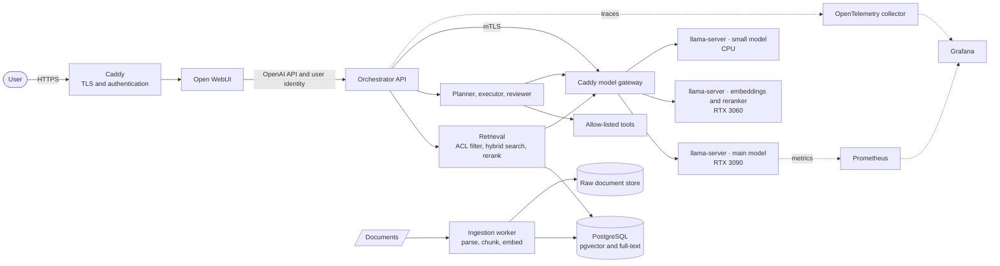
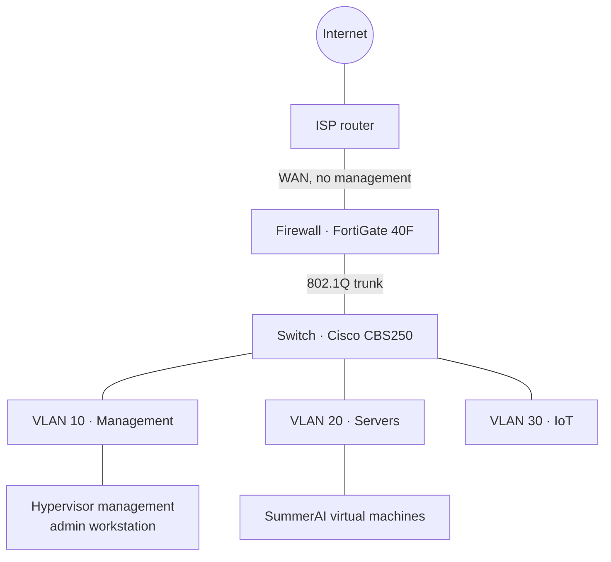

# Architecture

> **Status:** target design for v1. No component is deployed yet; each section
> says which [milestone](roadmap.md) delivers it.

## Goals

- Answer questions over a private document corpus with **citations**, using
  models that run on hardware the operator controls.
- Enforce **who can read what** inside retrieval, not only in the UI.
- Expose models through **one authenticated gateway**, with mutual TLS for
  machine clients, so backends can change without touching clients.
- Make quality and performance **measurable**: evaluation, traces, metrics and
  benchmarks are part of the system, not an afterthought.

## Logical architecture

### Query path

1. The reverse proxy terminates TLS and authenticates the user.
2. Open WebUI sends the conversation to the orchestrator through the OpenAI
   API, together with the user identity.
3. The orchestrator asks the retrieval service for context. Retrieval applies
   the user's access rights **in the database query**, then runs vector and
   full-text search, fuses the results and reranks them.
4. The orchestrator generates the answer through the gateway, either directly
   or through the agent layer, and returns it with citations.
5. Each step emits a trace span; the gateway and model servers expose
   metrics.

### Ingestion path

1. A document is submitted with its access rights.
2. The worker stores the original, extracts text, chunks it with the
   configured strategy and computes embeddings.
3. Chunks, embeddings, metadata, version and access rights are written in one
   transaction. A new version of a document replaces the previous chunks.

## Components

| Component | Technology | Role | Milestone |
|---|---|---|---|
| Reverse proxy and model gateway | Caddy | TLS, user authentication, mutual TLS for machine clients, routing, limits | M1 ([ADR 0008](adr/0008-gateway-caddy-mtls.md)) |
| Chat UI | Open WebUI | User interface | M2 |
| Orchestrator API | Python, FastAPI | OpenAI-compatible endpoint, retrieval, generation, citations | M2 |
| Retrieval store | PostgreSQL with pgvector | Vectors, full-text index, documents, versions, ACLs | M2 ([ADR 0004](adr/0004-retrieval-store.md)) |
| Ingestion worker | Python | Parsing, chunking, embeddings, versioning | M2 |
| Main model | llama.cpp `llama-server` | Chat and agent model on the RTX 3090 | M1 ([ADR 0006](adr/0006-llama-server-runtime.md), [ADR 0007](adr/0007-one-lxc-per-gpu.md)) |
| Embeddings and reranker | llama.cpp `llama-server` | Encode chunks and queries, rerank candidates, on the RTX 3060; models chosen by evaluation | M2 ([ADR 0006](adr/0006-llama-server-runtime.md)) |
| CPU inference | llama.cpp `llama-server` | Small model for the quickstart without GPU, and background jobs on the R730 | M1 ([ADR 0006](adr/0006-llama-server-runtime.md)) |
| Agent layer | Python, typed JSON schemas | Planner, executor, reviewer, tool allow-list | M4 |
| Observability | OpenTelemetry, Prometheus, Grafana | Traces, metrics, dashboards, alerts | M3 |
| Evaluation | Python | Golden dataset, retrieval and generation metrics | M3 |

## Infrastructure

SummerAI runs in a homelab built like a small production network: segmented
VLANs, a firewall that routes and filters between them, and two Proxmox VE
hypervisors.

### Hardware

| Host | Role | CPU | RAM | GPU | Storage |
|---|---|---|---|---|---|
| `merlin` | GPU hypervisor (tower PC) | Intel Core i5-14400F, 10 cores (6 performance, 4 efficient) | 32 GB DDR5 | NVIDIA RTX 3090, 24 GB, and RTX 3060, 8 GB | Over 2 TB (NVMe, SSD, HDD) |
| `kaamelott` | Main hypervisor (Dell PowerEdge R730) | 2 × Intel Xeon E5-2680 v4, 28 cores | 96 GB DDR4 ECC | None | 2.4 TB, hardware RAID 5 |
| `lancelot` | Firewall, inter-VLAN routing, DHCP, internal DNS (Fortinet FortiGate 40F) | — | — | — | — |
| `bohort` | Switch (Cisco CBS250, 16 × 1 GbE and 2 × SFP) | — | — | — | — |

Both hypervisors run Proxmox VE. The R730 also has out-of-band management
(iDRAC).

Hosts are named after characters of the French TV series *Kaamelott*.

### Network

| Zone | Purpose |
|---|---|
| VLAN 10, Management | Hypervisor and network device management, admin workstation |
| VLAN 20, Servers | Virtual machines and services, including SummerAI |
| VLAN 30, IoT | Connected devices, isolated from the rest |
| Unused native VLAN | Native VLAN of every trunk and unused port; carries no traffic |
| Recovery network | Untagged, out-of-band access to the firewall only |

Principles already in place:

- Traffic between VLANs is **denied by default**; each flow needs an explicit,
  logged firewall rule.
- Management is only reachable from the management VLAN, never from the WAN.
- Only encrypted management protocols (SSH, HTTPS); Telnet and HTTP are off.
- Unused switch ports are disabled and parked in the unused VLAN.
- Hypervisors accept SSH keys only; the web UI requires two-factor
  authentication.
- Network device configurations are backed up daily and versioned.
- Nothing is exposed to the internet. Remote access will go through a
  WireGuard VPN.

### Proposed placement

| Guest | Type | Host | Runs |
|---|---|---|---|
| LLM | LXC, RTX 3090 | `merlin` | `llama-server` with the main model, local Caddy |
| Retrieval models | LXC, RTX 3060 | `merlin` | `llama-server` for embeddings and for the reranker, local Caddy |
| Platform | VM | `kaamelott` | Caddy gateway, Open WebUI, orchestrator, retrieval, PostgreSQL, ingestion |
| Batch worker | VM | `kaamelott` | CPU `llama-server` and background jobs (bulk ingestion, asynchronous agents) |
| Observability | VM | `kaamelott` | Prometheus, Grafana, log storage |

Each GPU has one role and one container ([ADR 0007](adr/0007-one-lxc-per-gpu.md)).
Everything that does not need a GPU runs on `kaamelott`, which has far more
memory.

All guests sit in VLAN 20. Traffic between them stays inside the VLAN and does
not cross the firewall, so each guest runs a host firewall that only accepts
the flows it needs: the model servers only accept the gateway, over mutual
TLS ([ADR 0008](adr/0008-gateway-caddy-mtls.md)).

Flows to add to the firewall flow matrix:

| From | To | Port | Purpose |
|---|---|---|---|
| Management VLAN | Platform VM | 443/tcp | UI and API |
| Management VLAN | SummerAI VMs | 22/tcp | Administration, Ansible |
| SummerAI VMs | Internet | 443/tcp | Container images, packages, model downloads |

## Open questions

- **GPU host kernel and driver**: Proxmox VE 9.2 ships kernel 7.0 by default,
  and users report NVIDIA driver problems with it on RTX 30-series cards. The
  host stays on a kernel validated with both cards until 7.0 is confirmed.
- **Raw document store**: an S3-compatible service or a plain volume. The
  distribution model of MinIO's community edition changed in 2025 and needs
  checking; Garage and SeaweedFS are alternatives.
- **Time synchronisation**: NTP is not configured on every device yet; it is
  needed to correlate traces and logs.
