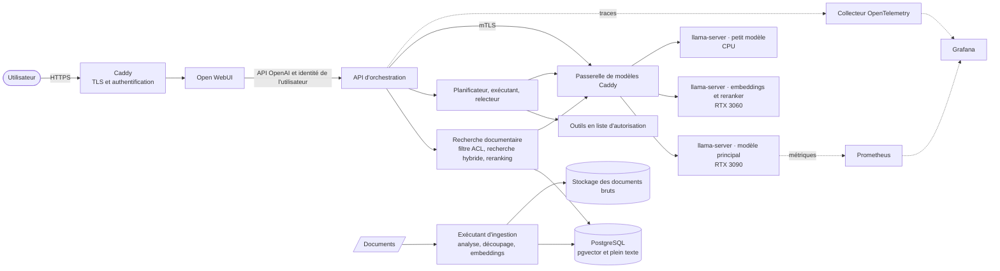
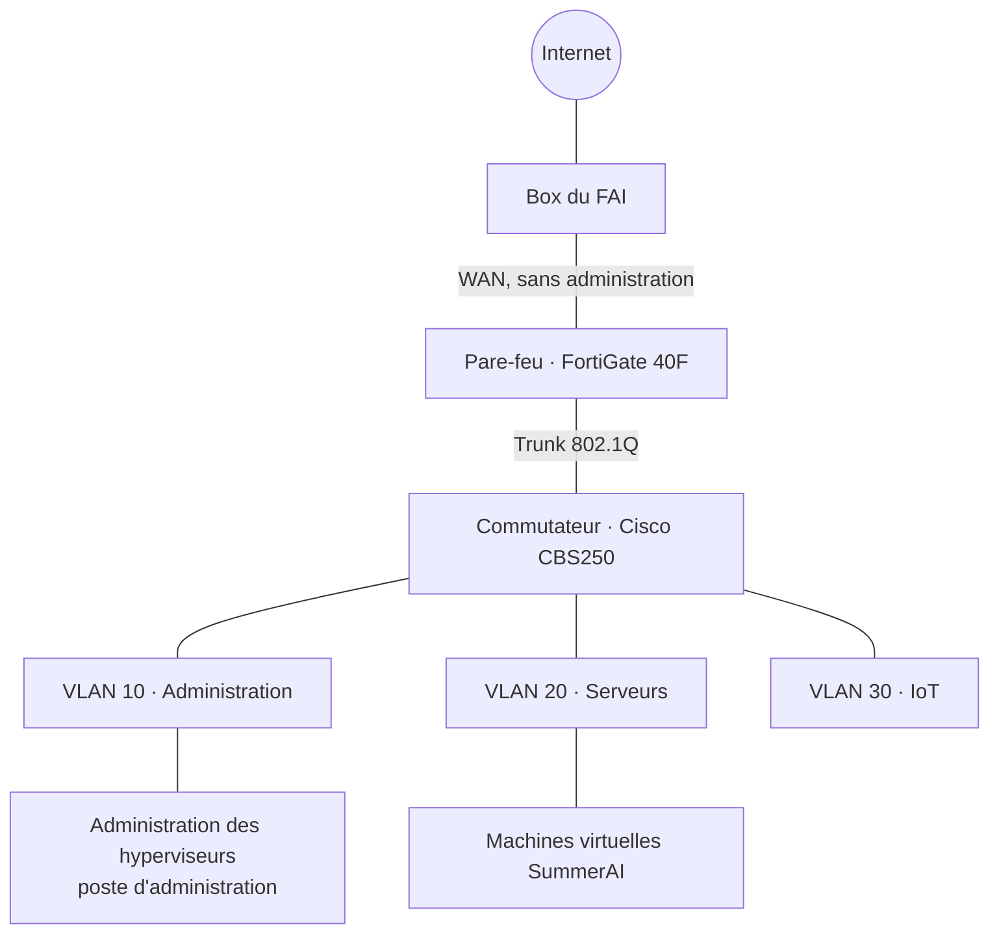

# Architecture

> **État :** conception cible de la v1. Aucun composant n'est encore déployé ;
> chaque section indique quel [jalon](roadmap.md) le livre.

## Objectifs

- Répondre aux questions sur un corpus documentaire privé avec des
  **citations**, à l'aide de modèles qui tournent sur un matériel que
  l'opérateur maîtrise.
- Appliquer **qui peut lire quoi** dans la recherche documentaire elle-même,
  pas seulement dans l'interface.
- Exposer les modèles via **une seule passerelle authentifiée**, avec TLS
  mutuel pour les clients machines, afin de pouvoir changer les backends sans
  toucher aux clients.
- Rendre la qualité et les performances **mesurables** : évaluation, traces,
  métriques et mesures font partie du système, pas d'un ajout après coup.

## Architecture logique

### Chemin d'une requête

1. Le reverse proxy termine le TLS et authentifie l'utilisateur.
2. Open WebUI envoie la conversation à l'orchestrateur via l'API OpenAI, avec
   l'identité de l'utilisateur.
3. L'orchestrateur demande du contexte au service de recherche documentaire.
   Celui-ci applique les droits d'accès de l'utilisateur **dans la requête à
   la base de données**, puis lance une recherche vectorielle et une recherche
   plein texte, fusionne les résultats et les reclasse (reranking).
4. L'orchestrateur génère la réponse via la passerelle, directement ou via la
   couche d'agents, et la renvoie avec ses citations.
5. Chaque étape émet un span de trace ; la passerelle et les serveurs de
   modèles exposent des métriques.

### Chemin d'ingestion

1. Un document est soumis avec ses droits d'accès.
2. L'exécutant stocke l'original, extrait le texte, le découpe selon la
   stratégie configurée et calcule les embeddings.
3. Les fragments, embeddings, métadonnées, version et droits d'accès sont
   écrits dans une seule transaction. Une nouvelle version d'un document
   remplace les fragments précédents.

## Composants

| Composant | Technologie | Rôle | Jalon |
|---|---|---|---|
| Reverse proxy et passerelle de modèles | Caddy | TLS, authentification des utilisateurs, TLS mutuel pour les clients machines, routage, limites | M1 ([ADR 0008](adr/0008-gateway-caddy-mtls.md)) |
| Interface de chat | Open WebUI | Interface utilisateur | M2 |
| API d'orchestration | Python, FastAPI | Point d'accès compatible OpenAI, recherche documentaire, génération, citations | M2 |
| Stockage de recherche | PostgreSQL avec pgvector | Vecteurs, index plein texte, documents, versions, ACL | M2 ([ADR 0004](adr/0004-retrieval-store.md)) |
| Exécutant d'ingestion | Python | Analyse, découpage, embeddings, gestion des versions | M2 |
| Modèle principal | llama.cpp `llama-server` | Modèle de chat et d'agents sur la RTX 3090 | M1 ([ADR 0006](adr/0006-llama-server-runtime.md), [ADR 0007](adr/0007-one-lxc-per-gpu.md)) |
| Embeddings et reranker | llama.cpp `llama-server` | Encoder fragments et requêtes, reclasser les candidats, sur la RTX 3060 ; modèles choisis par évaluation | M2 ([ADR 0006](adr/0006-llama-server-runtime.md)) |
| Inférence CPU | llama.cpp `llama-server` | Petit modèle pour le démarrage rapide sans GPU, et tâches de fond sur le R730 | M1 ([ADR 0006](adr/0006-llama-server-runtime.md)) |
| Couche d'agents | Python, schémas JSON typés | Planificateur, exécutant, relecteur, liste d'autorisation des outils | M4 |
| Observabilité | OpenTelemetry, Prometheus, Grafana | Traces, métriques, tableaux de bord, alertes | M3 |
| Évaluation | Python | Jeu de référence, métriques de recherche documentaire et de génération | M3 |

## Infrastructure

SummerAI tourne dans un homelab construit comme un petit réseau de production :
VLAN segmentés, un pare-feu qui route et filtre entre eux, et deux
hyperviseurs Proxmox VE.

### Matériel

| Hôte | Rôle | CPU | RAM | GPU | Stockage |
|---|---|---|---|---|---|
| `merlin` | Hyperviseur GPU (PC tour) | Intel Core i5-14400F, 10 cœurs (6 performance, 4 efficaces) | 32 Go DDR5 | NVIDIA RTX 3090, 24 Go, et RTX 3060, 8 Go | Plus de 2 To (NVMe, SSD, HDD) |
| `kaamelott` | Hyperviseur principal (Dell PowerEdge R730) | 2 × Intel Xeon E5-2680 v4, 28 cœurs | 96 Go DDR4 ECC | Aucun | 2,4 To, RAID 5 matériel |
| `lancelot` | Pare-feu, routage inter-VLAN, DHCP, DNS interne (Fortinet FortiGate 40F) | — | — | — | — |
| `bohort` | Commutateur (Cisco CBS250, 16 × 1 GbE et 2 × SFP) | — | — | — | — |

Les deux hyperviseurs tournent sous Proxmox VE. Le R730 dispose aussi d'une
gestion hors bande (iDRAC).

Les hôtes portent des noms de personnages de la série télévisée française
*Kaamelott*.

### Réseau

| Zone | Usage |
|---|---|
| VLAN 10, Administration | Administration des hyperviseurs et des équipements réseau, poste d'administration |
| VLAN 20, Serveurs | Machines virtuelles et services, dont SummerAI |
| VLAN 30, IoT | Objets connectés, isolés du reste |
| VLAN natif inutilisé | VLAN natif de chaque trunk et de chaque port inutilisé ; ne transporte aucun trafic |
| Réseau de secours | Non tagué, accès hors bande au pare-feu uniquement |

Principes déjà en place :

- Le trafic entre VLAN est **refusé par défaut** ; chaque flux nécessite une
  règle de pare-feu explicite et journalisée.
- L'administration n'est joignable que depuis le VLAN d'administration, jamais
  depuis le WAN.
- Uniquement des protocoles d'administration chiffrés (SSH, HTTPS) ; Telnet et
  HTTP sont désactivés.
- Les ports inutilisés du commutateur sont désactivés et placés dans le VLAN
  inutilisé.
- Les hyperviseurs n'acceptent que les clés SSH ; l'interface web exige une
  authentification à deux facteurs.
- Les configurations des équipements réseau sont sauvegardées chaque jour et
  versionnées.
- Rien n'est exposé à Internet. L'accès distant passera par un VPN WireGuard.

### Placement proposé

| Invité | Type | Hôte | Exécute |
|---|---|---|---|
| LLM | LXC, RTX 3090 | `merlin` | `llama-server` avec le modèle principal, Caddy local |
| Modèles de recherche | LXC, RTX 3060 | `merlin` | `llama-server` pour les embeddings et pour le reranker, Caddy local |
| Plateforme | VM | `kaamelott` | Passerelle Caddy, Open WebUI, orchestrateur, recherche documentaire, PostgreSQL, ingestion |
| Exécutant de traitements par lots | VM | `kaamelott` | `llama-server` CPU et tâches de fond (ingestion en masse, agents asynchrones) |
| Observabilité | VM | `kaamelott` | Prometheus, Grafana, stockage des journaux |

Chaque GPU a un rôle et un conteneur ([ADR 0007](adr/0007-one-lxc-per-gpu.md)).
Tout ce qui n'a pas besoin de GPU tourne sur `kaamelott`, qui a beaucoup plus
de mémoire.

Tous les invités sont dans le VLAN 20. Le trafic entre eux reste dans le VLAN
et ne traverse pas le pare-feu : chaque invité exécute donc un pare-feu local
qui n'accepte que les flux dont il a besoin. Les serveurs de modèles
n'acceptent que la passerelle, en TLS mutuel
([ADR 0008](adr/0008-gateway-caddy-mtls.md)).

Flux à ajouter à la matrice de flux du pare-feu :

| Source | Destination | Port | Usage |
|---|---|---|---|
| VLAN d'administration | VM Plateforme | 443/tcp | Interface et API |
| VLAN d'administration | VM SummerAI | 22/tcp | Administration, Ansible |
| VM SummerAI | Internet | 443/tcp | Images de conteneurs, paquets, téléchargement des modèles |

## Questions ouvertes

- **Noyau et pilote de l'hôte GPU** : Proxmox VE 9.2 fournit par défaut le
  noyau 7.0, et des utilisateurs signalent des problèmes de pilote NVIDIA avec
  ce noyau sur les cartes RTX série 30. L'hôte utilise un noyau 6.17 épinglé,
  validé avec les deux cartes ([runbook](runbooks/gpu-host.md)), jusqu'à ce
  que le 7.0 soit confirmé.
- **Stockage des documents bruts** : un service compatible S3 ou un simple
  volume. Le modèle de distribution de l'édition communautaire de MinIO a
  changé en 2025 et doit être vérifié ; Garage et SeaweedFS sont des
  alternatives.
- **Synchronisation de l'heure** : NTP n'est pas encore configuré sur tous les
  équipements ; il est nécessaire pour corréler traces et journaux.
