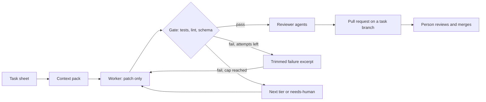

# Delegated worker loop

> **Status: proposed, not built.** This document describes the development
> workflow that SummerAI is going to use to build itself, and the work items
> that make it real. Nothing here has been measured yet. Every number that
> appears later comes from a script in this repository, as the
> [contribution rules](../CONTRIBUTING.md) require.

## What it is

A development workflow in which **local models plan, verify and supervise, and a
remote model only produces code, configuration or long documents**. Git is the
shared state. A person keeps the decisions: design, validation and merge.

It exists for one reason: remote models are better at heavy production, but
their usage is metered, so every token spent on exploring, summarising or
planning is a token not spent on producing.

This is a workflow for **building** SummerAI and the repositories around it. It
is not part of the product. The product keeps its promise that private
documents never leave the platform: nothing from the retrieval corpus, and
nothing from a repository marked private, is sent to a remote worker unless
that repository explicitly allows it.

## Principles

1. **A script before a model.** What can be computed is computed: result
   summaries, comparisons, parameter sweeps, link and secret checks.
2. **Local first, remote last.** Local models first, then a cheap remote tier,
   then a premium model only when the cheaper ones failed.
3. **Remote workers are stateless.** Each call gets a task sheet and a small
   context pack, and returns a patch. No exploration, no long conversation.
4. **Deterministic checks decide.** Tests, linters and schema validation pass
   or fail a patch. A model reviewer comments afterwards and cannot override a
   failing check.
5. **Everything is capped.** Attempts per task, cost per task, wall-clock time
   per night. A stuck task goes to a person.
6. **Everything is journalled.** Who did what, why, with which inputs and at
   what cost.
7. **A person merges.** No automatic merge, ever.

## How a task runs



1. **Task sheet.** The local orchestrator writes the goal, the constraints and
   acceptance criteria that can be run as commands.
2. **Context pack.** Only the files and snippets the task needs, found by the
   [retrieval index](https://github.com/rem-lit/SummerAI/issues/6), under a
   size budget and after a secret scan.
3. **Worker call.** A fresh, short session returns a unified diff and nothing
   else. A response that is not a valid diff is rejected.
4. **Gate.** The patch is applied in a throwaway container with no secrets and
   no network access. Tests, linters and schema checks decide.
5. **Retry or escalate.** On failure, only a trimmed failure excerpt goes
   back. After the attempt cap, the task moves to the next tier of its chain,
   and after the last tier it is marked `needs-human`.
6. **Review.** Reviewer agents other than the author comment on the patch.
   Findings above a severity threshold become issues, labelled for the agent
   class that should handle them.
7. **Pull request.** The result is a pull request from a task branch. A
   person reviews and merges.

## Who does what

| Actor | Does | Does not |
|---|---|---|
| Person | Design decisions, validation, priorities, review and merge | Read raw logs a script can summarise |
| Scripts | Result summaries, comparisons, sweeps, builds, checks, reports | Anything that needs judgement |
| Local models | Task sheets, context packs, reviews, documentation drafts, small fixes, iterative attempts on measurable code | Decide design, validate by feel |
| Cheap remote tier | Code the local models could not produce within the cap | Read recordings or plan |
| Premium model | Hard code: refactors across files, bugs that resisted the cheaper tiers | Explore a repository, summarise, plan, search |

## Choosing a model per project

Each repository has a `.workers.yaml` with task classes and, for each class, a
chain of backends from cheapest to most capable. Switching a model is a
configuration change.

```yaml
default: cheap
classes:
  docs_tests_boilerplate: { chain: [cheap] }
  feature:                { chain: [cheap, mid, premium] }
  hard_bug_refactor:      { chain: [mid, premium] }
backends:
  cheap:   { model: "<flash-tier model>" }
  mid:     { model: "<mid-tier model>" }
  premium: { cli: "claude -p", model: "<model>" }
limits: { max_attempts: 3, max_cost_per_task_usd: 0.50 }
```

Backends sit behind one adapter: a headless CLI, any OpenAI-compatible hosted
API, or the local `llama-server`, which is also a free test double in CI. The
same file records whether the repository's content may be sent to a remote
worker. The default is no.

Which model sits in which tier is decided by **cost per solved task**, measured
on our own tasks, not by price per token or by public leaderboards.

## Night batch

The local models can work while nobody is watching, as long as the work is
bounded:

- a stop time, a maximum number of attempts and a wall-clock cap per task;
- one branch or worktree per task, in a sandbox without network access;
- stuck detection: the same failure twice in a row ends the task;
- a morning report: tasks passed and failed, attempts, duration and the last
  failure of each task that did not pass.

## Supervision

See the [supervision issue](https://github.com/rem-lit/SummerAI/issues/4).

- **Action journal.** Append-only, one structured event per action, with the
  actor, the action type, a one-line rationale, references to inputs and
  outputs by hash, tokens, cost and a trace identifier. Raw journals and full
  transcripts stay on the homelab; only aggregated, sanitised results are
  published.
- **Channel between models.** Typed messages (question, proposal, critique,
  decision request, handoff) mediated by the orchestrator, with a turn cap
  and a size cap per thread. The person can read any thread and join it.
- **Telegram.** The person's window, not the transport between models: the
  morning report, alerts and a few explicit commands, from an allow-listed
  user. Messages pass through a third party's servers, so they carry
  summaries and identifiers only, never secrets or private content.

## Repository baseline and review by other agents

See the [baseline issue](https://github.com/rem-lit/SummerAI/issues/7).

Every new repository starts with the same baseline before its first feature:
secret scanning, dependency updates, static analysis, linters, tests in CI, a
protected `main`, templates, and a documented deployment with a manual approval
for production.

Pull requests are then reviewed by agents **other than the author**, each with
a narrow role (consistency, security, tests and documentation). Their findings
are structured, and the ones above a threshold become issues assigned, through
a label, to the agent class that should fix them. Review rounds are capped and
no agent merges.

## Control plane

See the [control plane issue](https://github.com/rem-lit/SummerAI/issues/5).

- Before v0 there is no web application: the command line, the report command
  and Telegram are enough.
- The loop console and the platform deployment stay separate. The loop console
  reads the journal and acts on the loop. Deployment stays in version-controlled
  Terraform and Ansible, run from the repository.
- Later, one front with two pages: a **public page** built from a sanitised,
  scanned export of aggregated results, and a **private page** with runs,
  threads and controls behind the gateway.
- Existing tools are preferred to writing schedulers and retries by hand; the
  choice is made after a time-boxed spike.

## Timeline

| Date | Step |
|---|---|
| 2026-10-24 | Loop v0 working end to end |
| 2026-10-24 to 2026-10-28 | Measured run on real tasks |
| 2026-10-28 | Review of the measurements and decision on the next step |

## Work items

| Issue | Subject |
|---|---|
| [#3](https://github.com/rem-lit/SummerAI/issues/3) | Delegated worker loop |
| [#4](https://github.com/rem-lit/SummerAI/issues/4) | Supervision: journal, channel between models, Telegram |
| [#5](https://github.com/rem-lit/SummerAI/issues/5) | Control plane: adopt an existing tool or build |
| [#6](https://github.com/rem-lit/SummerAI/issues/6) | Retrieval over the git repositories |
| [#7](https://github.com/rem-lit/SummerAI/issues/7) | Repository baseline and review by other agents |

The loop is an early, scoped version of the orchestrator described for
milestone M4 and of "Model choice by context" in the
[idea backlog](ideas.md). The decision record is
[ADR 0009](adr/0009-delegated-worker-loop.md).
