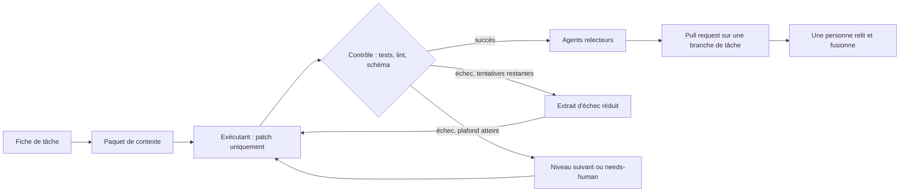

# Boucle de travail déléguée

> **État : proposé, non construit.** Ce document décrit le flux de travail de
> développement que SummerAI va utiliser pour se construire lui-même, et les
> tâches qui le rendent réel. Rien n'a encore été mesuré. Chaque chiffre qui
> apparaîtra plus tard viendra d'un script de ce dépôt, comme l'exigent les
> [règles de contribution](../CONTRIBUTING.md).

## Ce que c'est

Un flux de travail de développement dans lequel **des modèles locaux
planifient, vérifient et supervisent, et un modèle distant ne produit que du
code, de la configuration ou des documents longs**. Git est l'état partagé.
Une personne garde les décisions : conception, validation et fusion.

Il existe pour une seule raison : les modèles distants sont meilleurs pour la
production lourde, mais leur usage est facturé au volume. Chaque jeton dépensé
à explorer, résumer ou planifier est un jeton qui ne sert pas à produire.

C'est un flux de travail pour **construire** SummerAI et les dépôts qui
l'entourent. Il ne fait pas partie du produit. Le produit tient sa promesse :
les documents privés ne quittent jamais la plateforme. Rien du corpus de
recherche documentaire, et rien d'un dépôt marqué privé, n'est envoyé à un
exécutant distant, sauf si ce dépôt l'autorise explicitement.

## Principes

1. **Un script avant un modèle.** Ce qui peut être calculé est calculé :
   synthèses de résultats, comparaisons, balayages de paramètres, contrôles de
   liens et de secrets.
2. **Le local d'abord, le distant en dernier.** D'abord les modèles locaux,
   puis un niveau distant bon marché, puis un modèle premium seulement quand
   les moins chers ont échoué.
3. **Les exécutants distants sont sans état.** Chaque appel reçoit une fiche
   de tâche et un petit paquet de contexte, et renvoie un patch. Pas
   d'exploration, pas de longue conversation.
4. **Les contrôles déterministes décident.** Tests, linters et validation de
   schéma acceptent ou rejettent un patch. Un relecteur modèle commente
   ensuite et ne peut pas passer outre un contrôle en échec.
5. **Tout est plafonné.** Tentatives par tâche, coût par tâche, durée réelle
   par nuit. Une tâche bloquée revient à une personne.
6. **Tout est journalisé.** Qui a fait quoi, pourquoi, avec quelles entrées et
   pour quel coût.
7. **Une personne fusionne.** Jamais de fusion automatique.

## Déroulement d'une tâche



1. **Fiche de tâche.** L'orchestrateur local rédige l'objectif, les
   contraintes et des critères d'acceptation exécutables sous forme de
   commandes.
2. **Paquet de contexte.** Uniquement les fichiers et extraits dont la tâche a
   besoin, trouvés par l'[index de recherche
   documentaire](https://github.com/rem-lit/SummerAI/issues/6), dans un budget
   de taille et après une recherche de secrets.
3. **Appel à l'exécutant.** Une session neuve et courte renvoie un diff
   unifié et rien d'autre. Une réponse qui n'est pas un diff valide est
   rejetée.
4. **Contrôle.** Le patch est appliqué dans un conteneur jetable, sans secrets
   et sans accès réseau. Tests, linters et contrôles de schéma décident.
5. **Nouvelle tentative ou escalade.** En cas d'échec, seul un extrait d'échec
   réduit est renvoyé. Une fois le plafond de tentatives atteint, la tâche
   passe au niveau suivant de sa chaîne, et après le dernier niveau elle est
   marquée `needs-human`.
6. **Relecture.** Des agents relecteurs autres que l'auteur commentent le
   patch. Les constats au-dessus d'un seuil de gravité deviennent des
   tickets, étiquetés pour la classe d'agents qui doit les traiter.
7. **Pull request.** Le résultat est une pull request (PR) depuis une branche
   de tâche. Une personne la relit et la fusionne.

## Qui fait quoi

| Acteur | Fait | Ne fait pas |
|---|---|---|
| Personne | Décisions de conception, validation, priorités, relecture et fusion | Lire des journaux bruts qu'un script peut résumer |
| Scripts | Synthèses de résultats, comparaisons, balayages, builds, contrôles, rapports | Tout ce qui demande du jugement |
| Modèles locaux | Fiches de tâche, paquets de contexte, relectures, brouillons de documentation, petits correctifs, tentatives itératives sur du code mesurable | Décider de la conception, valider au jugé |
| Niveau distant bon marché | Le code que les modèles locaux n'ont pas pu produire dans le plafond | Lire des enregistrements ou planifier |
| Modèle premium | Le code difficile : refactorisations sur plusieurs fichiers, bugs qui ont résisté aux niveaux moins chers | Explorer un dépôt, résumer, planifier, chercher |

## Choisir un modèle par projet

Chaque dépôt a un fichier `.workers.yaml` avec des classes de tâches et, pour
chaque classe, une chaîne de backends du moins cher au plus capable. Changer
de modèle est un changement de configuration.

```yaml
default: cheap
classes:
  docs_tests_boilerplate: { chain: [cheap] }
  feature:                { chain: [cheap, mid, premium] }
  hard_bug_refactor:      { chain: [mid, premium] }
backends:
  cheap:   { model: "<flash-tier model>" }
  mid:     { model: "<mid-tier model>" }
  premium: { cli: "claude -p", model: "<model>" }
limits: { max_attempts: 3, max_cost_per_task_usd: 0.50 }
```

Les backends sont derrière un seul adaptateur : une CLI sans interface, toute
API hébergée compatible OpenAI, ou le `llama-server` local, qui sert aussi de
doublure de test gratuite en CI. Le même fichier indique si le contenu du
dépôt peut être envoyé à un exécutant distant. Par défaut, non.

Le modèle placé à chaque niveau est choisi selon le **coût par tâche
résolue**, mesuré sur nos propres tâches, et non selon le prix par jeton ou
les classements publics.

## Traitement de nuit

Les modèles locaux peuvent travailler sans surveillance, tant que le travail
est borné :

- une heure d'arrêt, un nombre maximal de tentatives et un plafond de durée
  réelle par tâche ;
- une branche ou un worktree par tâche, dans un bac à sable sans accès
  réseau ;
- détection de blocage : le même échec deux fois de suite met fin à la
  tâche ;
- un rapport du matin : tâches réussies et échouées, tentatives, durée et
  dernier échec de chaque tâche qui n'a pas réussi.

## Supervision

Voir le [ticket sur la supervision](https://github.com/rem-lit/SummerAI/issues/4).

- **Journal des actions.** En ajout seul, un événement structuré par action,
  avec l'acteur, le type d'action, une justification en une ligne, des
  références aux entrées et sorties par empreinte, les jetons, le coût et un
  identifiant de trace. Les journaux bruts et les transcriptions complètes
  restent dans le homelab ; seuls des résultats agrégés et assainis sont
  publiés.
- **Canal entre modèles.** Messages typés (question, proposition, critique,
  demande de décision, passage de relais) relayés par l'orchestrateur, avec
  un plafond de tours et un plafond de taille par fil. La personne peut lire
  n'importe quel fil et y participer.
- **Telegram.** La fenêtre de la personne, pas le transport entre modèles :
  le rapport du matin, les alertes et quelques commandes explicites, depuis un
  utilisateur en liste d'autorisation. Les messages passent par les serveurs
  d'un tiers : ils ne contiennent donc que des résumés et des identifiants,
  jamais de secrets ni de contenu privé.

## Socle des dépôts et relecture par d'autres agents

Voir le [ticket sur le socle](https://github.com/rem-lit/SummerAI/issues/7).

Chaque nouveau dépôt démarre avec le même socle avant sa première
fonctionnalité : recherche de secrets, mises à jour des dépendances, analyse
statique, linters, tests en CI, une branche `main` protégée, des templates,
et un déploiement documenté avec une approbation manuelle
pour la production.

Les pull requests sont ensuite relues par des agents **autres que l'auteur**,
chacun avec un rôle étroit (cohérence, sécurité, tests et documentation).
Leurs constats sont structurés, et ceux qui dépassent un seuil deviennent des
tickets attribués, via une étiquette, à la classe d'agents qui doit les
corriger. Les cycles de relecture sont plafonnés et aucun agent ne fusionne.

## Plan de contrôle

Voir le [ticket sur le plan de contrôle](https://github.com/rem-lit/SummerAI/issues/5).

- Avant la v0, il n'y a pas d'application web : la ligne de commande, la
  commande de rapport et Telegram suffisent.
- La console de la boucle et le déploiement de la plateforme restent séparés.
  La console de la boucle lit le journal et agit sur la boucle. Le déploiement
  reste dans Terraform et Ansible, sous gestion de versions, et s'exécute
  depuis le dépôt.
- Plus tard, une seule interface avec deux pages : une **page publique**
  construite à partir d'un export assaini et analysé des résultats agrégés, et
  une **page privée** avec les exécutions, les fils et les commandes, derrière
  la passerelle.
- Les outils existants sont préférés à l'écriture à la main d'ordonnanceurs et
  de mécanismes de nouvelle tentative ; le choix se fait après un essai
  technique limité dans le temps.

## Calendrier

| Date | Étape |
|---|---|
| 2026-10-24 | Boucle v0 fonctionnelle de bout en bout |
| Du 2026-10-24 au 2026-10-28 | Exécution mesurée sur des tâches réelles |
| 2026-10-28 | Revue des mesures et décision sur l'étape suivante |

## Tâches

| Ticket | Sujet |
|---|---|
| [#3](https://github.com/rem-lit/SummerAI/issues/3) | Boucle de travail déléguée |
| [#4](https://github.com/rem-lit/SummerAI/issues/4) | Supervision : journal, canal entre modèles, Telegram |
| [#5](https://github.com/rem-lit/SummerAI/issues/5) | Plan de contrôle : adopter un outil existant ou construire |
| [#6](https://github.com/rem-lit/SummerAI/issues/6) | Recherche documentaire sur les dépôts git |
| [#7](https://github.com/rem-lit/SummerAI/issues/7) | Socle des dépôts et relecture par d'autres agents |

La boucle est une version précoce et restreinte de l'orchestrateur décrit pour
le jalon M4 et de « Choix du modèle selon le contexte » dans le
[réserve d'idées](ideas.md). La décision d'architecture est
l'[ADR 0009](adr/0009-delegated-worker-loop.md).
